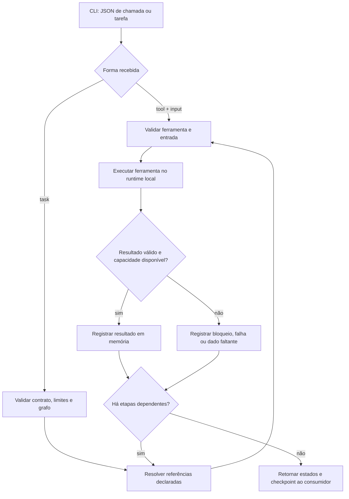

# Coordenação interna de tarefas

## Missão e fronteiras

O coordenador recebe a forma aditiva `{"task": ...}` no CLI de comunicação e executa, no processo do runtime, uma sequência curta de ferramentas já contratadas. A chamada simples mantém o caminho direto; uma tarefa composta declara etapas, dependências e referências explícitas a campos produzidos antes.

O coordenador não é um modelo, não cria processos ou subagentes e não encaminha texto para outro chat. Texto e resultados de ferramentas são dados, não instruções. O runtime não grava tarefa, conversa, saída ou checkpoint em disco.

## Entradas, saídas e seleção

A entrada usa `contracts/v1/task.schema.json`. Cada etapa nomeia uma das ferramentas `communication.respond`, `communication.transform`, `communication.transcribe`, `communication.synthesize` ou `communication.cancelTurn` e fornece a entrada normal dessa ferramenta. O grafo deve ser serial: dependências apontam apenas para etapas anteriores. Uma referência `{ "$resultFrom": "etapa", "field": "campo" }` só é aceita quando a dependência também foi declarada; o valor resolvido é novamente validado pelo contrato da ferramenta consumidora.

A saída segue `contracts/v1/task-result.schema.json`, com identificador, estado geral, estado e modo por etapa, resultados, dependências ausentes, entradas necessárias, limites e checkpoint. `executed` significa que uma capacidade contratada terminou; não significa que texto foi gerado, áudio ouvido ou fato verificado. Checkpoints retornados pelo consumidor são entrada não confiável: o runtime confere o digest da tarefa, os IDs, as ferramentas e os esquemas de resultado antes de reutilizar qualquer etapa concluída.

## Ferramentas e limites

| Limite | Padrão | Teto/condição |
| --- | ---: | --- |
| Bytes de entrada JSON | — | 80.000 |
| Etapas | 8 | 8 |
| Tempo | 60 s | 60 s |
| Tentativas por etapa | 1 | 2, somente para erro explicitamente recuperável |
| Concorrência | 1 | 1 |
| Profundidade de delegação | 0 | 0 |

O cancelamento é cooperativo entre etapas e depois de chamadas síncronas; uma chamada local já em curso não pode ser interrompida à força por este coordenador. O timeout também é observado entre etapas e após o retorno síncrono. Falhas deixam os estados parciais visíveis e bloqueiam somente consumidores dependentes; etapas independentes ainda podem executar.

O modelo Ollama é local e opt-in. Sem o modelo configurado, texto retorna bloqueio com dependência ausente, sem fallback remoto. STT/TTS retornam indisponível enquanto não houver provedor real. Um resultado marcado `simulated` provém de fixture de teste, nunca de inferência real.

## Fluxo

## Qualidade, falhas e retomada

Os testes comparam uma ferramenta direta e a composição resposta → tradução usando fixtures explicitamente marcadas como simuladas. A execução CLI sem modelo confirma apenas o bloqueio correto; não mede qualidade de idioma. A capacidade determinística `cancelTurn` é exercida pelo CLI como caminho real local, mas não comprova geração ou voz.

Entrada inválida falha antes de executar etapas. Ferramenta ou provedor indisponível é dependência ausente; entrada insuficiente pede esclarecimento; erro de ferramenta é falha; timeout e cancelamento preservam os estados concluídos. Retomar um checkpoint válido não repete etapas concluídas, mas seu conteúdo continua sendo validado como dado não confiável.

## Rastreabilidade

- Requisitos: [REQUIREMENTS.md](REQUIREMENTS.md), especialmente F01–F04 e N02, N05–N07.
- Arquitetura: [ARCHITECTURE_PLAN.md](ARCHITECTURE_PLAN.md).
- Competências: [SPECIALIZATIONS.md](SPECIALIZATIONS.md).
- Entrega: [issue #38](https://github.com/PHnsilva/sofiee-agent-communication/issues/38), S6, L=8. PR #37 é a dependência técnica aberta; este incremento é empilhado e não declara merge ou aceite.
